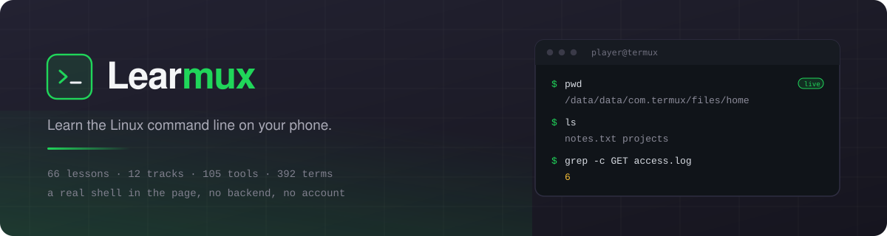
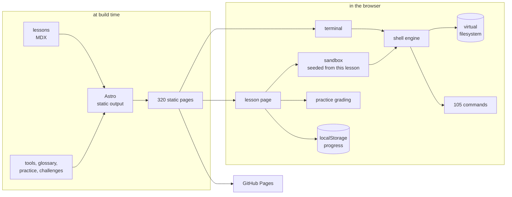
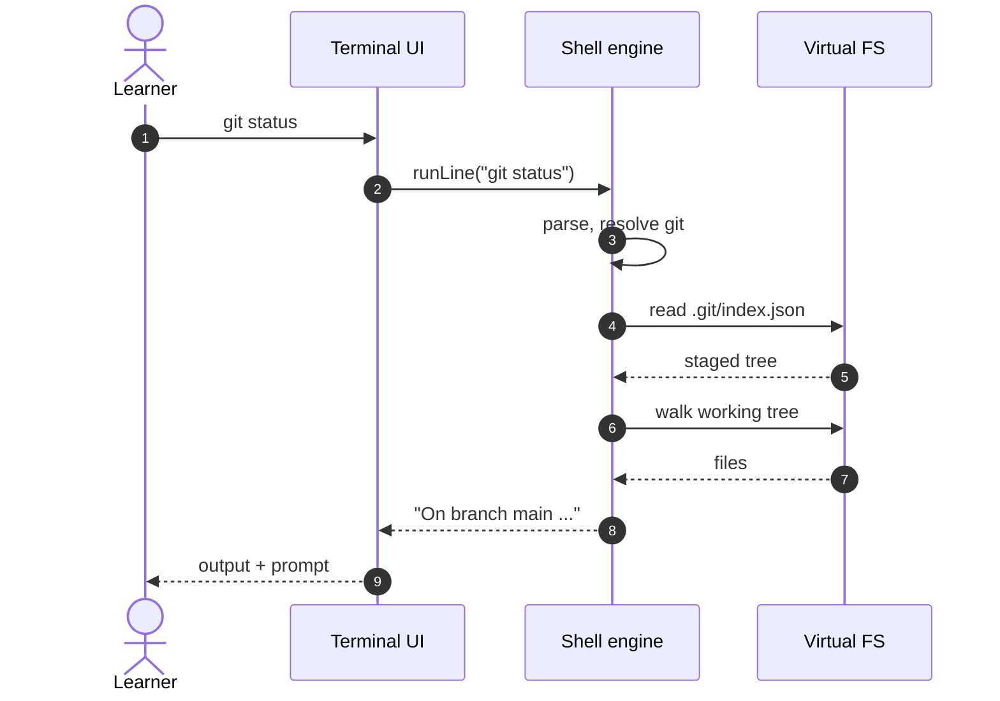
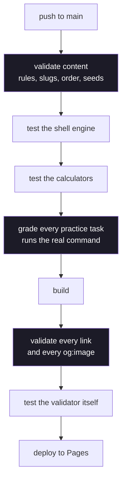

<div align="center">



<br />

**A Termux and Linux command-line course, with a real shell in the page.**

[](https://apsideslabs.github.io/Learmux/)
[](https://github.com/apsideslabs/Learmux/actions/workflows/deploy.yml)
[](LICENSE)
[](.nvmrc)
[](CONTRIBUTING.md)

[](#the-course)
[](#the-course)
[](#what-is-in-it)
[](#what-is-in-it)
[](#what-is-in-it)

[**Read the course**](https://apsideslabs.github.io/Learmux/course/) ·
[**Try the sandbox**](https://apsideslabs.github.io/Learmux/learn/pipes-and-redirection/) ·
[**Report a problem**](https://github.com/apsideslabs/Learmux/issues/new/choose) ·
[**Contribute**](CONTRIBUTING.md)

</div>

---

Most command-line courses tell you to run something and leave you to open a
terminal. Learmux puts the terminal beside the lesson, seeded with the files that
lesson talks about, so the command you are reading is the command you can type.

The course is written for a phone. Termux is a real Linux userland for Android,
and everything here assumes it: the paths, the package manager, the two editors
you actually have, and the fact that you are reading on a screen the size of a
hand.

```console
$ pwd
/data/data/com.termux/files/home
$ grep -c GET access.log
6
```

No backend, no account, no tracking. The site builds to static files.

## What is in it

| | |
| --- | --- |
| **66 lessons** across **12 tracks**, in a prerequisite order | **66 practice sets**: 261 questions, 66 graded output tasks |
| **A shell on every lesson page**, seeded with that lesson's files | **105 tools** documented, with flags, examples and a copy button |
| **392 glossary terms** across six subjects, linked to lessons | **18 challenges**: 12 in-browser labs and 6 Termux CTF |
| **6 calculators** that run offline | **A certificate** you can download as SVG or PNG |

## The course

Twelve tracks, meant to be read in order. Each track assumes the ones above it.

| # | Track | Level | Lessons |
| --- | --- | --- | --- |
| 1 | Foundations | Beginner | 8 |
| 2 | The shell in practice | Intermediate | 8 |
| 3 | Python you can run here | Beginner | 5 |
| 4 | Networking and the internet | Intermediate | 5 |
| 5 | Security fundamentals | Intermediate | 7 |
| 6 | Reconnaissance and assessment | Intermediate | 5 |
| 7 | Web and application security | Intermediate | 5 |
| 8 | Cryptography in practice | Intermediate | 5 |
| 9 | Defence and monitoring | Intermediate | 5 |
| 10 | Utilities you build yourself | Intermediate | 6 |
| 11 | Projects | Advanced | 3 |
| 12 | Working in security | Intermediate | 4 |

## How it works

Everything runs in the browser. There is no server to call, so the shell, the
grading, the progress and the certificate all live in the page.



A command goes in, the engine parses it, the command acts on the virtual
filesystem, and the output comes back. Nothing leaves the page.



## What is verified before it deploys

Every push runs the same gate. It is not decoration: each step has caught a real
defect in this repository.



The practice step is the unusual one. Each of the 66 output tasks is **run for
real** in a throwaway home directory and graded against its own rules, so a task
that cannot be completed fails the build rather than reaching a learner.

## Quick start

```bash
git clone https://github.com/apsideslabs/Learmux.git
cd Learmux
npm install
npm run dev          # http://localhost:4321/Learmux/
```

Node 20 (there is a `.nvmrc`). No environment variables, no database, no
services to start.

| Script | What it does |
| --- | --- |
| `npm run dev` | Local dev server with hot reload |
| `npm run build` | Build the static site to `dist/` |
| `npm run validate` | Check content rules, links and the built output |
| `npm test` | The shell engine: parsing, commands, filesystem, git |
| `npm run test:practice` | Run and grade every practice task for real |
| `npm run test:utilities` | The calculator logic |
| `npm run test:validator` | Prove the validator still catches what it should |
| `npm run generate:thumbs` | Redraw the lesson thumbnails |
| `npm run generate:og` | Rasterise the social images from those thumbnails |

## Project structure

```
src/
├── content/tutorials/     66 lessons, one MDX file each; the filename is the URL
├── data/
│   ├── tools/             105 documented commands, grouped by subject
│   ├── glossary/          392 terms across six subjects
│   ├── practice/          66 practice sets: questions and output tasks
│   └── challenges.json    12 in-browser challenges
├── lib/
│   ├── shell.ts           parse and dispatch
│   ├── commands.ts        105 commands
│   ├── fs.ts              the virtual filesystem
│   ├── git.ts             a small, real git
│   ├── lesson-sandbox.ts  per-lesson seeds
│   ├── practice-grade.ts  output grading rules
│   └── progress.ts        localStorage progress
├── pages/                 routes: course, learn, practice, tools, glossary,
│                          ctf, challenges, utilities, tags, profile, search
├── components/            terminal, sandbox, practice widgets, certificate
└── styles/                the palette and the layout
scripts/
├── validate-content.mjs   the content gate
├── test-practice.mjs      runs and grades every task
├── test-engine.mjs        the shell tests
└── generate-*.mjs         thumbnails, og images, challenges
docs/
├── banner.svg             the image at the top of this file
└── challenge-format.md    how a challenge is defined
```

## Contributing

Corrections to lesson content are the most useful thing you can send, and they
are the easiest to review. **Read [CONTRIBUTING.md](CONTRIBUTING.md) first**: it
lists the rules the build actually enforces, so you do not have to guess.

- [**Report a bug**](https://github.com/apsideslabs/Learmux/issues/new?template=bug_report.yml)
- [**Correct a lesson**](https://github.com/apsideslabs/Learmux/issues/new?template=content_correction.yml)
- [**Suggest a feature**](https://github.com/apsideslabs/Learmux/issues/new?template=feature_request.yml)
- [**Report a security issue**](SECURITY.md) (privately, please)

Everything is checked by `npm run validate` and `npm test`, so you can be sure a
pull request passes before you open it.

## What this is not

Being clear about the edges is more useful than overselling them.

- **The shell is not a real shell.** It is 105 commands over a virtual
  filesystem. `apt install` will not work, and nothing touches your device.
  Where it cannot match the real tool it says so, and the commands that matter
  (`grep`, `sed`, `git`) match the real ones closely.
- **The sandbox git has no branches or remotes.** It has the daily loop. The
  lesson says so in the text.
- **There are no publication dates**, because there is no honest source for them.
  The feed carries none for the same reason.
- **Progress is per browser.** It lives in `localStorage`; the certificate is a
  record of what you marked done, not a proctored credential.

## License

MIT. See [LICENSE](LICENSE).

<div align="center">
<br />
<a href="https://apsideslabs.github.io/grapheme/">
  <picture>
    <source media="(prefers-color-scheme: dark)" srcset="public/brand/apsides-labs-light.svg" />
    
  </picture>
</a>
<br /><br />
Designed and built by <a href="https://apsideslabs.github.io/grapheme/">Apsides Labs</a>.
</div>
